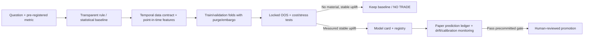

# إطار الذكاء الاصطناعي والتعلّم الآلي في Trading Intelligence

**الإصدار:** 0.3.0 · **الحالة الحالية:** لا يوجد نموذج ML/DL/RL مدرّب أو نتيجة أداء مدعاة.
هذا المستند يحدد متى يُسمح بإضافة نموذج، وما baseline الذي يجب أن يهزمه، وما البيانات والخدمات الخارجية المطلوبة.

## المبدأ الحاكم

الذكاء الاصطناعي ليس طبقة لتجميل قرار تداول غير مثبت. كل نموذج يجب أن يحل سؤالاً محدداً، يملك timestamped inputs متاحة قبل القرار، ويُقارن خارج العينة بخط أساس بسيط ومجمّد. إن لم يقدّم تحسناً قابلاً للقياس **بعد** التكاليف وعدم اليقين، يبقى الحل القاعدي أو الإحصائي هو المعتمد.



## مصفوفة قرار التقنية

| التقنية | السؤال المشروع | المدخلات الدنيا | baseline الإلزامي | متى تفيد فعلاً | متى تفضّل القواعد/الإحصاء |
|---|---|---|---|---|---|
| قواعد شفافة | هل تحقق FVG/structure/session/risk condition؟ | OHLCV/جلسة متاحة | لا شيء؛ هي baseline | الشروط قابلة للتعريف والإبطال والتفسير | دائماً كبداية، وخصوصاً مع عينات قليلة |
| إحصاء/سلاسل زمنية | ما regime/volatility/forecast interval؟ | returns نظيفة، تقويم، تكاليف | random walk، rolling mean، EWMA/AR baseline | تقدير uncertainty، volatility، residual diagnostics | إذا كانت العلاقة بسيطة أو البيانات قصيرة/غير مستقرة |
| Supervised ML | ما احتمال تحقق outcome محدد خلال horizon معلن؟ | features point-in-time + labels + folds | logistic/linear أو rule score | تفاعلات غير خطية متكررة وبيانات كافية متغايرة الأنظمة | labels نادرة، feature leakage، أو uplift غير ثابت |
| Deep Learning | هل توجد بنية متسلسلة/متعددة الوسائط لا يلتقطها baseline؟ | حجم بيانات كبير، GPU budget، split زمني صارم | boosting/TCN صغير/linear | فقط عند OOS lift ثابت وفوق تكلفة/تعقيد النموذج | OHLC قصير وحده؛ لا تستخدم LSTM لمجرد الاسم |
| Reinforcement Learning | كيف تنفذ/تجزئ أمراً تحت قيود وسيولة؟ | simulator واقعي للـfills/impact/queue | TWAP/VWAP/rule execution | execution policy في بيئة تحاكي السوق بدقة | ليس لاكتشاف اتجاه من OHLC؛ reward سهل التحايل |
| Pattern recognition | هل شكل/تسلسل محدد له تعريف قابل للإعادة؟ | OHLC أو ticks، labels مستقلة | detector هندسي/قواعد | classification لحدث مضبوط مع label quality | الصور الشمعية أو التسميات البصرية بعد النتيجة |
| Anomaly detection | هل feed/market state خارج المدى المعتاد؟ | returns/spread/volume/latency distribution | z-score/robust MAD/rules | data QA، volatility shocks، drift alert | لا يحول الشذوذ وحده إلى alpha |
| NLP للأخبار | ما نوع الحدث/الكيان/المفاجأة المتاحين زمنياً؟ | news license، publish/receive times، revisions | scheduled-event embargo + structured calendar | event extraction، entity mapping، surprise/uncertainty features | خبر بلا provenance أو latency/rights غير معروفة |
| Regime detection | هل السوق trend/range/high-vol/liquidity-stressed؟ | returns, volatility, volume/session | transparent rules الحالية | HMM/classifier فقط إن حسّن selection OOS | إذا لم يحسن تخصيص الاستراتيجية مقارنة بقاعدة بسيطة |

## عقود البيانات قبل التدريب

لا يبدأ تدريب قبل وجود العقود التالية:

```text
FeatureRecord
  feature_time_utc          # لحظة إتاحة feature، لا نهاية العينة المستقبلية
  instrument_identity       # XAUUSD_SPOT != GC.<expiry>
  feature_set_version
  source_manifest_hash
  values + missingness flags

LabelRecord
  decision_time_utc
  horizon / barrier / exit policy
  outcome_time_utc
  net-of-cost outcome
  label_version

ModelRun
  code_commit, dataset hashes, feature/label versions,
  split definition, trials, seed, hyperparameters,
  baseline result, OOS result, calibration/drift metrics
```

- يستخدم label فقط ما حدث **بعد** `decision_time`، ولا يدخل في feature vector.
- revisions الاقتصادية تحفظ بـvintage timestamp؛ النسخة المنقحة لا تعود إلى الماضي.
- أي feature من GC أو L2 يحمل هوية السوق الخاصة به ولا يدمج مع XAU/USD بلا اختبار ومحاذاة زمنية.
- missingness feature بحد ذاته مسجل؛ لا يملأ صفراً بصمت.

## منهج التحقق لكل نوع نموذج

1. **تجميد السؤال وmetric**: مثال: هل يرفع filter نسبة expectancy net-of-cost ضمن regime محدد؟ وليس «توقع السعر» بصورة مبهمة.
2. **اختيار baseline**: rule أو statistical model بسيط، محفوظ في experiment ledger.
3. **Temporal validation**: expanding/walk-forward. إذا تداخلت labels/horizons، تستخدم purge وembargo حول حدود folds.
4. **Model selection داخل train فقط**: لا يستخدم final holdout لاختيار features أو parameters أو threshold.
5. **اختبار OOS مقفل**: نفس cost/slippage، وشرائح instrument/session/regime/timeframe.
6. **اختبارات المتانة**: perturbation للـfeatures، missing feed، delay، wider costs، nearby thresholds، Monte Carlo، PBO/DSR عند تعدد التجارب.
7. **معايرة واحتمال**: reliability/Brier أو calibration curve للـprobabilities؛ لا يكفي accuracy.
8. **Decision utility**: يقاس الأثر الإضافي بعد de-correlation مقارنة بمحركات موجودة، لا مجرد AUC.
9. **Paper forward**: prediction يسجل في `ResearchLedger` قبل outcome؛ يرصد drift والـlatency.

أي فشل في lineage أو leakage أو final holdout يجعل حالة النموذج `RESEARCH_INCOMPLETE`.

## سياسات خاصة

### نماذج السلاسل الزمنية

- ابدأ بـnaive/random-walk، rolling mean، EWMA volatility، وAR/regularized regression حيث يناسب.
- ركز على intervals وvolatility/regime أكثر من point forecast؛ خطأ الاتجاه الصغير لا يساوي edge بعد spread.
- لا تفترض stationarity. اعرض diagnostics، وتحقق من تغير المعلمات وbreaks.

### Deep Learning

- لا يضاف PyTorch/JAX أو GPU pipeline قبل dataset كبير، baseline منافس، وقياس تكلفة inference/latency.
- يحفظ seed وarchitecture وnormalization وcheckpoint hash، ولا يعاد اختيار epoch على final OOS.
- attention أو transformer ليسا بديلاً عن feature lineage أو proper timestamps.

### Reinforcement Learning

- النطاق الأول المسموح هو **execution simulation**: timing/child-order allocation تحت limit/risk constraints.
- لا يسمح بتدريب RL ليقترح leverage أو يتجاوز `RiskManagementEngine`.
- simulator يجب أن يضم partial fills، spread، market impact، queue/latency أو يصرح أن التجربة غير صالحة لتقييم RL.

### أخبار وNLP

- تحفظ `published_at_utc` و`received_at_utc` وsource/license وrevision/duplicate relationship.
- المرحلة الأولى: event-risk embargo من calendar structured؛ ثم extraction/NER؛ ثم فقط sentiment/impact model إن أثبت incremental value.
- لا يفسر النظام خبراً منشوراً بعد الحركة على أنه دليل كان متاحاً وقت القرار.

### Anomaly وRegime

- anomaly monitor يفتح `data_quality` أو `risk` incident؛ لا يصدر BUY/SELL تلقائياً.
- regime model يستخدم في **اختيار/حجب** استراتيجية بعد اختبار ablation، وليس لتكرار إشارات مترابطة.
- إذا انخفضت calibration أو تغير data distribution، يعود النظام إلى baseline أو `NO_TRADE`.

## التقنيات المقترحة — غير مثبتة حالياً

| الحاجة | اختيار أولي | لماذا | متى لا تستخدمه |
|---|---|---|---|
| tabular/time features | Polars + Arrow/Parquet + DuckDB | schema/سرعة/reproducible batches | لا تضف cluster لملف صغير |
| baselines وإحصاء | NumPy/SciPy + statsmodels | تشخيص ونماذج قابلة للتفسير | لا تعتمد فقط على p-values بعد search واسع |
| supervised ML | scikit-learn، ثم LightGBM/XGBoost عند الحاجة | baselines ثم nonlinearity فعالة | لا قبل split/ledger/baseline |
| deep learning | PyTorch | ecosystem/model cards/checkpoints | لا قبل justification لحجم البيانات |
| NLP | Hugging Face/transformers أو spaCy حسب المهمة | tokenization/NER/fine-tuning | لا بدون license/timestamp/latency policy |
| experiment registry | MLflow أو registry أخف مبني على PostgreSQL | parameter/artifact lineage | لا تكرر MLflow إذا JSON ledger يكفي للـPoC |
| orchestration | Prefect أو Dagster | scheduling/retries/assets | لا قبل jobs متعددة حقيقية |

لم تثبت هذه المكتبات أو الخدمات في `pyproject.toml` كي لا توحي بأن ML قد شُغّل. تضاف كل dependency مع experiment محدد واختبار وترخيص وسياسة بيانات.

## مخرجات لوحة التحكم المطلوبة لاحقاً

- model card، dataset/feature/label hashes، baseline مقابل candidate، OOS slices.
- calibration/drift/missingness/latency، وليس «ثقة» مجردة.
- current regime واحتماله، مع نسخة model وقاعدة fallback.
- كل prediction مع `as_of`, outcome pending/resolved، وlink إلى ledger hash.
- kill/pause عند stale feed أو data incident أو risk limit.

التصميم المعماري العام في [`ARCHITECTURE_AR.md`](ARCHITECTURE_AR.md)، والمصادر/الواجهات في [`DATA_SOURCES_AR.md`](DATA_SOURCES_AR.md). لا يمثل هذا المستند توصية باستخدام نموذج معقد أو دعوى بوجود أداء.
