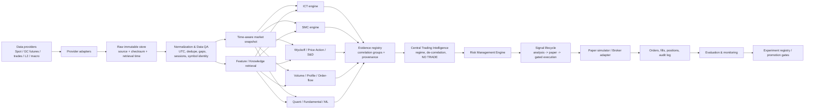

# التصميم المعماري لنظام Trading Intelligence

**الإصدار:** 0.1.0 · **الوضع التشغيلي الحالي:** `ANALYSIS_ONLY` محلي وبدون أي feed متصل.
التصميم يفصل عمداً البحث والتحليل والورق والتنفيذ. لا يجوز اختصار هذه المسارات لمجرد أن جميعها تستخدم كلمة "signal".

## 1) المعمارية المستهدفة



### حدود الثقة والأمان

| الحد | مسؤولية | حظر صريح |
|---|---|---|
| Provider adapter | تحويل رد المزود كما هو وحفظ raw lineage | لا يخترع OHLC أو حجم أو timezone |
| Normalizer/QA | identity، UTC، complete bars، gaps، quality score | لا يمزج XAU/USD وGC أو BID/ASK/MID |
| Snapshot | منح المحرك فقط ما كان متاحاً عند `as_of` | لا future bars ولا revised news بلا timestamp |
| School engine | مفهوم واحد/مجموعة مفاهيم مدروسة وevidence قابل للإعادة | لا يحدد حجم الصفقة أو يرسل أمراً |
| Central engine | de-correlation/regime/conflict/NO_TRADE | لا يعتبر تعدد الأسماء استقلالاً |
| Risk engine | رأس المال، limits، correlation، events، sizing | لا يغير الاتجاه لإرضاء العائد |
| Signal engine | validation + lifecycle | لا يصدر actionable signal ببيانات غير موثقة |
| Execution adapter | idempotency/order state/reconciliation/kill switch | لا live access قبل approval مستقل |

## 2) مخطط تدفق القرار

```mermaid
sequenceDiagram
    participant P as Provider
    participant Q as Data QA
    participant S as Snapshot(as_of)
    participant E as Engines
    participant C as Central
    participant R as Risk
    participant T as Trade Signal

    P->>Q: raw data + source metadata
    Q->>Q: verify timestamps / complete / gaps / identity
    Q->>S: immutable closed bars only
    S->>E: same point-in-time data per timeframe
    E->>C: EngineReports + evidence + invalidations
    C->>C: cap correlated evidence / check HTF conflict
    alt weak, conflicting, unavailable, or incomplete
        C-->>T: NO_TRADE with reasons
    else hypothesis qualifies
        C->>R: direction + explicit levels + portfolio state
        R->>R: limits / event embargo / quantity / correlation
        alt risk fails
          R-->>T: BLOCKED / NO_TRADE
        else paper mode & verified data
          R-->>T: PAPER_CANDIDATE
        end
    end
    T-->>T: audit record; no live order in v0.1
```

`NO_TRADE` نتيجة أولى وليست خطأً أو حالة افتراضية مخفية. وفي الإصدار الأول لا يتجاوز أي قرار بوابة `ANALYSIS_ONLY`.

## 3) نماذج البيانات والواجهات

### مفاتيح الهوية والـlineage

```text
InstrumentIdentity
  canonical_id: XAUUSD_SPOT | GC.<expiry> | GC_CONTINUOUS.<roll_policy>
  venue/provider/symbol
  asset_kind: spot_cfd | futures | equity | crypto_spot | crypto_perp
  quote_currency, price_component: BID | ASK | MID | LAST | SETTLEMENT
  contract/multiplier/tick/lot: provider- and account-specific

RawRecord
  provider, request parameters, received_at_utc, payload hash, schema version,
  license/retention tag, parser version

NormalizedBar
  instrument_identity, open_time_utc, close_time_utc, timeframe,
  o,h,l,c, volume, volume_semantics, is_complete, quality_flags, raw_record_id
```

**قاعدة الذهب:** `XAU/USD` spot/CFD و`GC` future منتجان مختلفان. للعقد GC (COMEX) وحدة 100 troy ounces وحد أدنى $0.10/oz بحسب rulebook CME؛ وتؤكد CME ذلك أيضاً في overview المنتج [SRC-CME-GC-RULEBOOK](../knowledge/sources.json) [SRC-CME-GC-OVERVIEW](../knowledge/sources.json). فرق الاستحقاق والـroll وbasis والجلسة ومصدر الحجم يمنع استبدال أحدهما بالآخر. يمكن استخدام GC كـcontext لفرضية مستقلة بعد محاذاة/اختبار، لا كأنه شمعة XAU/USD.

### العقد الداخلي الحالي (موجود في الكود)

| object | الملف | الحقول/الوظيفة الأساسية |
|---|---|---|
| `Candle` | `models.py` | OHLCV وفتح/إغلاق timezone-aware مع invariants |
| `FeedMetadata` | `models.py` | provider, instrument kind, price component, mode, source URL, verified/quality |
| `MarketSnapshot` | `models.py` | `as_of` + bars مقفلة فقط حسب timeframe |
| `Evidence` | `models.py` | score [-1,1]، confidence، correlation group، measurement، concept ID |
| `EngineReport` | `models.py` | direction، regime، أدلة/أدلة مضادة/إلغاء/مدخلات ناقصة |
| `Decision` | `models.py` | action، أدلة مختارة ومرفوضة لارتباطها، أسباب/invalidation |
| `RiskAssessment` | `models.py` | approval، quantity، cash risk، reward/risk، أسباب |
| `TradeSignal` | `models.py` | signal candidate ممهور بالمصدر والمخاطر والحالة؛ ليس order |

### عقود واجهات المرحلة التالية

```python
class MarketDataProvider(Protocol):
    def list_instruments(self) -> list[InstrumentIdentity]: ...
    def fetch_bars(self, request: BarRequest) -> RawResponse: ...
    def stream_quotes(self, request: QuoteRequest) -> AsyncIterator[RawQuote]: ...

class EconomicCalendarProvider(Protocol):
    def events(self, start_utc: datetime, end_utc: datetime) -> list[EconomicEvent]: ...

class ExecutionVenue(Protocol):
    def validate_order(self, draft: OrderDraft) -> ValidationResult: ...
    def submit_idempotent(self, draft: OrderDraft, client_order_id: str) -> VenueOrder: ...
    def get_order(self, client_order_id: str) -> VenueOrder: ...
    def emergency_flatten(self, approval: HumanApproval) -> list[VenueOrder]: ...
```

لن تنفذ هذه الواجهات في `LIVE` إلا بعد مرحلة approval صريحة منفصلة؛ وجود interface ليس اتصالاً ولا تفويضاً.

## 4) المحركات واستقلال المسؤولية

| المحرك | ما يملكه | ما لا يملكه | حالة v0.1 |
|---|---|---|---|
| ICT | FVG وequal-high/low sweep heuristics بإصدار | تعريف SMC أو دليل order book | منفذ تجريبي |
| SMC | structure + displacement/order-block proxy | تنفيذ ICT أو sizing | منفذ تجريبي |
| Price Action | pivots وstructure | مستويات order block | منفذ تجريبي |
| Volume | relative-volume confirmation إذا كان المعنى معروفاً | volume profile/CVD من OHLC | منفذ تجريبي |
| Quant | SMA 20/50 + volatility gate كـbaseline | claims ML/alpha | منفذ تجريبي |
| Wyckoff | state machine phase/event | — | backlog بمواصفة |
| Supply/Demand & Classical | geometry/zone detectors | — | backlog |
| Profile | TPO/VAP/session auction | footprints | backlog وfeed خاص |
| Order Flow | delta/CVD/footprint/L2 | OHLC proxy مزعوم كبيانات حقيقية | يعلن unavailable |
| Fundamental | calendar/news/macros | تفسير خبر بلا مصدر | يعلن unavailable |
| ML | calibrated models/feature store | تدريب على holdout | gated backlog |

كل `Evidence` يربط بـ`source_concept_id` في knowledge base. المركز لا يقرأ اسم المدرسة ليعطي وزناً، بل يتعامل مع القياس وcorrelation group وإصدار القاعدة ونتيجة ablation المسجلة لاحقاً.

## 5) اختيار التقنيات

| الطبقة | الآن | عند الإنتاج بعد PoC | المبرر |
|---|---|---|---|
| Core domain | Python 3.11+، stdlib/dataclasses | Python 3.12+, Pydantic v2 عند API boundaries | قابلية قراءة واختبار وخطوات research سريعة |
| Dataframes | لا dependency في v0.1 | Polars + Arrow/Parquet | أداء عمودي وschema واضح للبيانات الكبيرة |
| Storage | JSON knowledge/versioned files | object storage للraw Parquet + PostgreSQL/TimescaleDB للmetadata + DuckDB للبحث | raw immutable مقابل queryable metadata |
| Workflows | commands/tests محلية | Prefect/Dagster + queue | retries، lineage، schedules |
| API/dashboard | لا خدمة حالية | FastAPI + React/TypeScript | API typed وواجهات decision/audit |
| Event bus/cache | لا حاجة | Kafka/Redpanda + Redis | streams وidempotency بعد تبرير الحجم |
| ML experiment | لا ML | MLflow + feature registry (أو بديل أبسط أولاً) | reproducibility/model lineage |
| Observability | stdout/tests | OpenTelemetry + Prometheus/Grafana + append-only audit | latency/data quality/risk alerts |
| Deployment | لا نشر | Docker + IaC + secret manager | فصل المفاتيح والصلاحيات وتكرار البيئة |

هذه اقتراحات؛ لا توجد الحزم أو الخدمات أو مفاتيح API مثبتة في هذا الفرع حالياً.

## 6) هيكل الملفات الحالي والمستهدف

```text
knowledge/
  concepts.json                 # definitions/rules/relations/sources/version
  sources.json                  # registry of source provenance
src/trading_intelligence/
  models.py                     # domain contracts
  data.py                       # complete-bar and chronology validation
  knowledge.py                  # source-validated deterministic concept retrieval
  knowledge_data/               # packaged mirror of the canonical registry
  orchestration.py              # independent multi-TF engine runner
  central.py                    # evidence de-correlation/NO_TRADE
  risk.py                       # capital protection and sizing
  signals.py                    # analysis/paper safety gate
  engines/
    indicators.py               # transparent no-lookahead primitives
    technical.py                # first independent engines
  research/metrics.py           # metrics, bootstrap, temporal folds
tests/                          # 14 local deterministic tests (current)
docs/
  TRADING_INTELLIGENCE_RESEARCH_AR.md
  DATA_SOURCES_AR.md
  VALIDATION_AR.md
```

المستهدف لاحقاً يضيف `providers/`, `normalization/`, `feature_store/`, `backtest/`, `paper/`, `execution/`, `api/`, `dashboard/`, `migrations/` و`infra/`، مع عدم وضع أسرار أو raw licensed data في Git.

## 7) التنفيذ المرحلي ومعايير البوابة

| المرحلة | التسليم | بوابة الخروج (لا ادعاء نجاح قبل تحققها) |
|---|---|---|
| 1. المعرفة والبحث | registry + concepts + policy | مراجعة مصدر/إصدار لكل rule، وفصل definition عن evidence |
| 2. محركات المدارس | detectors مستقلة وfixtures | unit/replay tests وconcept mapping لكل output |
| 3. العقل المركزي | calibration/de-correlation/regime | ablation وcorrelation analysis على OOS فقط |
| 4. البيانات | adapter واحد read-only + raw lineage | QA، timestamps، gaps، spot/GC identity، reconciliation مع vendor |
| 5. signals | levels/expiry/cancel conditions | لا signal عند stale/unverified/missing inputs |
| 6. risk | portfolio/exposure/news correlation | property tests وlimits في حالات فشل متعددة |
| 7. backtest | event-driven fills/cost/roll model | benchmark known fixtures + no-lookahead audits |
| 8. paper | append-only predictions/fills | reconciliation وفترة forward precommitted |
| 9. improvement | locked experiment registry + model gates | final OOS untouched + drift monitoring |
| 10. live study | venue adapter + human approval | disaster drills, security review, explicit user approval؛ لا auto-go-live |

## 8) التنفيذ الحقيقي: تصميم مؤجل ومقيد

قبل أي دراسة live، يطلب النظام: حساب مخصص، صلاحيات أقل ما يمكن، idempotency key، order validation، max notional، kill switch، reconciliation عند إعادة الاتصال، event log غير قابل للمحو، وموافقة بشرية لكل تفعيل. ليس في المشروع كود يتصل بوسيط أو يستخدم credentials، وبناءً على طلب المستخدم لا يجب إضافته أو تشغيله من دون موافقة صريحة لاحقة.
