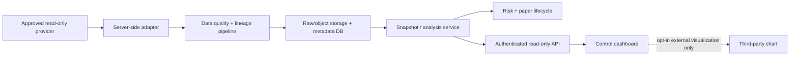

# لوحة التحكم وحدود العرض الخارجي

## الحالة الحالية

`dashboard/` لوحة static عربية تعمل من دون backend أو اتصال بوسيط. هي واجهة توضيح لحالة النظام المحلية وليست terminal تداول ولا تقدم توصية مالية.

- القرار المعروض: `NO TRADE` صناعي فقط.
- وضع النظام: `ANALYSIS_ONLY`.
- لا تطلب الواجهة endpoint للأسعار أو المحركات أو الحسابات.
- لا تُخزن مفاتيح أو بيانات اعتماد ولا تتصل بوسيط.
- ملف `vercel.json` يضيف security headers وCSP وقيود capabilities للمتصفح.

## تبويب التنفيذ الورقي

يعرض التبويب العقد الذي يطبقه الكود المحلي، ولا ينفذ زرّاً:

1. يلزم `ExecutionPolicy` صريحة تتضمن `InstrumentRiskSpec` لكل رمز مسموح، و`quantity step/minimum`، وحدود notional وworst-case cash risk عند ضبطها.
2. لا يُرسل سوى lifecycle محلي؛ لا يوجد adapter أو مفاتيح اتصال.
3. يعالج الانقطاع بـ`UNKNOWN`، ثم snapshot موثوق مع cumulative quantity قبل اعتبار أي fill معروفاً.
4. يمكن ربط transitions بـ`ResearchLedger` JSONL hash-chain على تخزين دائم. هذه حماية من العبث المحلي وليست بديلاً عن WORM/object storage أو audit خارجي.

راجع [EXECUTION_SAFETY_AR.md](EXECUTION_SAFETY_AR.md) لقواعد الترقية الكاملة.

## مساحة الرسم الخارجي

أضيفت مساحة الرسم بناءً على ملف HTML المرفق، ولكن عُدلت لتكون **حداً أمنياً واضحاً**:

- الرسم لا يُحمّل تلقائياً؛ يبدأ فقط بعد اختيار المستخدم والضغط على «تحميل الرسم الخارجي».
- يفتح في `iframe` sandboxed بلا `allow-same-origin` وبـ`referrerpolicy=no-referrer`.
- الرمز الافتراضي للعرض `OANDA:XAUUSD`؛ خيار `COMEX:GC1!` ظاهر منفصلاً حتى لا يُستبدل spot XAU/USD بعقد GC بصمت.
- البيانات المعروضة من TradingView طرف ثالث، وقد تتأخر أو تختلف في session/symbol/pricing؛ ليست data contract ولا تدخل Python أو المحركات أو إشارة أو sizing أو Paper lifecycle.
- يستطيع المستخدم «إزالة الرسم»؛ عندها يعود iframe إلى `about:blank`.

حتى لو عُرض مخطط خارجي بنجاح، يظل النظام `ANALYSIS_ONLY` و`NO TRADE`. لا يعني ذلك تحقق freshness أو quality أو اكتمال bar أو قابلية استخدام البيانات في backtest/forward-paper.

## النشر

تُنشر اللوحة من جذر `dashboard/` فقط. قبل النشر شغّل:

```bash
PYTHONPATH=src python -m unittest discover -s tests -v
python -m json.tool dashboard/vercel.json
```

لا تضف API key أو broker secret أو vendor credential إلى `dashboard/` أو Vercel client-side environment. مزود موثوق يجب أن يبقى server-side، وتحت data contract وapproval منفصلين.

## مساحة التحكم المتكاملة

إصدار الواجهة `V0.8` يضيف **Research Operations Desk** فوق أقسام المحركات:

- اختيار أداة وإطار للعرض (`XAU/USD` و`GC` منفصلان، مع EUR/USD وUS500 وAAPL وBTC/USD، وM1 إلى D1) مع Watchlist مخصصة للعرض فقط.
- مزامنة اختيار العرض مع مساحة الرسم الخارجي، ولكن لا يبدأ تحميل طرف ثالث قبل الضغط الصريح على زر التحميل.
- حفظ تفضيلات العرض فقط في `localStorage` تحت مفتاح محلي؛ لا تحفظ أسعاراً أو snapshots أو API keys أو حسابات.
- زر نسخ ملخص حالة محلي يوضح `ANALYSIS_ONLY` و`NO_TRADE` وغياب feed/broker؛ لا ينشئ تقرير سوق أو أمر تداول.
- System Rails تعرض بوضوح ما هو محلي جاهز وما هو غير موصول، بدلاً من استخدام مؤشرات نجاح زائفة.

## مسار التكامل المقترح

لا يتصل المتصفح مباشرة بمزود بيانات أو OANDA أو broker. المسار المستهدف بعد الموافقات هو:



واجهة المستخدم تقرأ summary وsnapshots المعتمدة من API مستقبلاً عبر URLs نسبية ومصادقة/RBAC. لا يجوز وضع provider token أو DB key أو broker secret في JavaScript أو Vercel public environment. `Supabase` أو PostgreSQL يمكن استخدامهما لاحقاً للـmetadata/RLS/audit، لكن لا توجد قاعدة بيانات أو اتصال Supabase مهيأ حالياً.
