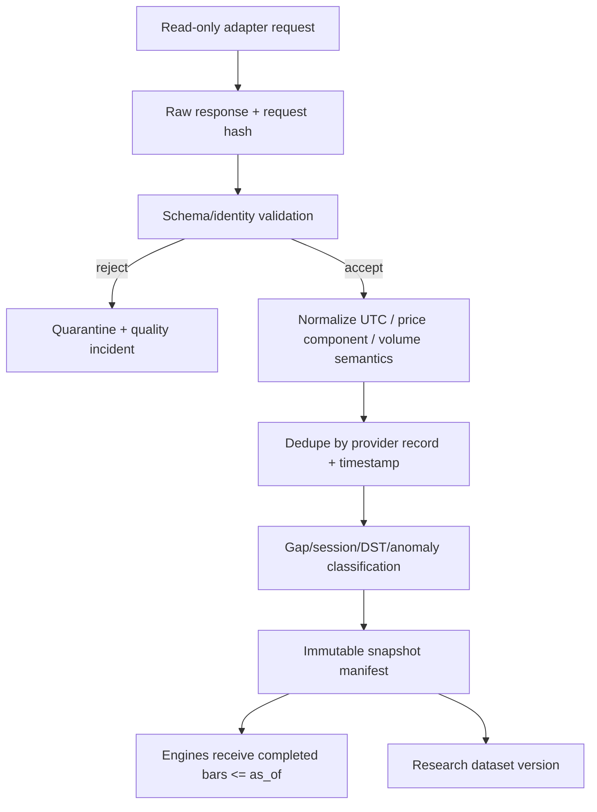

# طبقة بيانات السوق: المصادر، الواجهات، والهوية

**الحالة الحالية:** لا يوجد مزود موصول ولا بيانات حقيقية/لحظية تم تنزيلها. كل اسم هنا مرشح تكاملي يتطلب مراجعة رخصته وتوفره الجغرافي/الحسابي وشروطه وحدود طلباته قبل الاعتماد عليه.

## 1) متطلبات غير قابلة للتفاوض

1. كل record يحمل: `provider`, `vendor_symbol`, `canonical_instrument_id`, `instrument_kind`, `price_component`, `timezone=UTC`, `retrieved_at`, `source/request`, parser/schema version، وquality flags.
2. الشمعة لا تدخل المحرك حتى تكون `complete=true` أو ما يعادلها من المزود. مثال OANDA يعرّف حقل `complete` للشمعة [SRC-OANDA-COMPLETE-BAR](../knowledge/sources.json).
3. لا يُملأ gap بصمت، ولا تُرتب duplicates أو تعديلات vendor بلا raw record وحادثة audit.
4. لا تُخلط prices: bid/ask/mid/last/settlement، ولا volume: tick/trade/contract/estimated.
5. يحتفظ النظام بنسخة raw غير قابلة للتعديل ونسخة normalized لها checksum؛ التصحيح إضافة record جديد لا overwrite صامت.
6. للـbacktest، يتطلب المصمم تحديد ما كان معروفاً `as_of` ونوع latency/availability، وليس timestamp سعر فقط.

## 2) XAU/USD مقابل GC: فصل الهوية

| الخاصية | XAU/USD spot أو CFD | GC futures (COMEX) | قرار التصميم |
|---|---|---|---|
| طبيعة السعر | quote من broker/provider؛ قد تختلف تسميته وشروطه بين الحسابات | عقد آجل محدود الاستحقاق ومتداول في venue | `instrument_kind` إلزامي |
| الرمز | مثل `XAU_USD` أو `XAUUSD` حسب المزود | `GC` **مع شهر/سنة العقد** أو continuous roll policy | لا mapping ضمني |
| الحجم | قد يكون tick count أو CFD volume | volume/open interest للعقد وفق المصدر | `volume_semantics` إلزامي |
| العقد | lot/multiplier/tick broker-specific | GC: 100 troy oz، tick $0.10/oz وفق CME | `InstrumentRiskSpec` لا يستنتج من الاسم |
| السعر | قد يعكس spread/provider pricing | يحمل basis، expiry، delivery/roll effects | لا يستبدل spot بـGC للentries أو PnL |
| الوقت والجلسة | calendar broker | exchange/Globex/holiday/roll calendar | session calendar حسب المنتج |

توثق CME أن GC عقد 100 oz وحده الأدنى $10 لكل tick [SRC-CME-GC-RULEBOOK](../knowledge/sources.json). هذه معلومة عن GC وليست تصريحاً عن حجم lot أو قيمة نقطة XAU/USD في أي وسيط.

## 3) خريطة المصادر المرشحة

### الأسعار/الشموع لـXAU/USD

| مصدر مرشح | نوع محتمل | ما يجب التحقق منه قبل الدمج | نهج الواجهة |
|---|---|---|---|
| OANDA REST-v20 | broker/account market data; candles/pricing | توفر XAU/USD لهذا الحساب/المنطقة، pricing component، account-specific feed، limits/licensing | adapter read-only؛ `complete` فقط؛ لا تخزن token في Git |
| وسيط المستخدم المنظم أو مزود FX مؤسسي | spot/CFD tick/OHLC | الرمز، bid/ask، historical vs live differences، شروط إعادة النشر | adapter خاص موثق بالعقد |
| مزود market-data مرخّص | historical FX/metals | coverage، adjustments، timestamps، redistribution rights | bulk importer إلى immutable storage |

توثق OANDA endpoint للشموع `instrument`, `price`, `granularity`, `from/to` وتوضح أن candles التاريخية وpricing الحي يمكن أن يختلفا حسب pricing group [SRC-OANDA-CANDLES](../knowledge/sources.json). ليس هناك اتصال OANDA مكوّن في هذا المشروع.

### GC futures والـmicrostructure

| حاجة | فئة مصدر مرشح | شرط قبول |
|---|---|---|
| historical/daily/intraday GC | licensed CME data vendor أو broker approved feed | عقد محدد، timestamps، expiry/roll metadata، volume/OI semantics |
| trade prints/L1/L2 | licensed exchange market-data feed | entitlement، sequence handling، quote/trade timestamps، recovery rules |
| volume profile/footprint | tick or price-level executed volume | لا اشتقاق من XAUUSD tick-volume؛ session/contract explicit |
| calendar/roll | exchange calendar/product specs | versioned holiday/roll schedule |

لا تنشئ طبقة البيانات `GC_CONTINUOUS` قبل كتابة roll policy (calendar/volume/open-interest، back-adjustment أو ratio، وأثرها على returns). يحتفظ الباكتيست بالعقود الفردية ومصدر series المستمر.

### الماكرو والأخبار

| النوع | مزود/واجهة مطلوبة | حقول واجبة |
|---|---|---|
| تقويم اقتصادي | مصدر مرخّص/API رسمي عند الإمكان | event ID, scheduled UTC, actual, consensus, prior, revision, source timestamps |
| بيانات اقتصادية | الجهات الناشرة أو مرخص | vintage/revision timestamp، release calendar، units |
| أخبار | API مرخّص مع rights | headline/body policy، published/received UTC، source, entity/event extraction version |
| أسعار/rates/DXY/ETF/options | datasets ذات ترخيص منفصل | instrument identity، calendar، close type، adjustment policy |

الأخبار تدخل أولاً في **event-risk embargo**. لا يحق لـNLP أن يحول feed بلا timestamps موثقة إلى دعوى سببية.

## 4) دورة بيانات موثقة

### Quality rules

| الاختبار | الإجراء |
|---|---|
| `high < max(open,close)` أو `low > min(open,close)` | reject |
| timestamp naïve أو غير متزايد أو duplicate | reject/quarantine |
| bar غير مكتمل عند `as_of` | لا يدخل snapshot |
| gap | warning/classification؛ لا forward-fill للتداول دون policy |
| مصدر/رمز مجهول | reject |
| سعر شاذ | flag ثم cross-check؛ لا auto-correct |
| تغير schema/provider | توقف adapter إلى أن يراجع parser |
| stale live feed | `NO_TRADE` + alert، لا reuse للسعر القديم |

## 5) خارطة تنفيذ data adapter الأولى

**المرحلة المقترحة:** مصدر OHLCV واحد read-only لأداة واحدة، تاريخي فقط أولاً. لا تحتاج credentials لإتمام النماذج الحالية، لكن عند الموافقة يتطلب adapter:

1. `DataProviderConfig` من environment/secret manager، لا في ملف/commit.
2. `fetch_bars()` مع request log redacted وrate-limit/retry/backoff.
3. حفظ raw payload gzip/Parquet حسب الترخيص مع hash وrequest parameters.
4. parser ينشئ `Candle` و`FeedMetadata` ويمر على `validate_closed_candles`.
5. integration fixture مخزن أو mock مع: duplicate، gap، incomplete last bar، DST/session boundary، bad OHLC.
6. reconciliation sample يومي مع واجهة vendor ووثيقة expected counts.
7. snapshot manifest يربط كل analysis/backtest بـdata version.

لن نبدأ streaming أو broker execution في هذه المرحلة. ولا نضع API key أو نحاول الاتصال بحساب دون موافقة المستخدم الصريحة.

## 6) سياسة التحديث والمراقبة لاحقاً

- **تاريخي:** import idempotent بالـrange + manifest؛ لا يكرر آخر bar (`includeFirst`/equivalent يضبط بحذر).
- **live:** heartbeat + watermark per instrument/timeframe؛ complete-bar poll أو aggregation موثق؛ reconnect/reconcile sequenced data.
- **news/calendar:** polling/versioned revisions؛ embargo عند provider down وليس افتراض "لا أخبار".
- **anomaly:** spread/return/volume/timestamp detectors تفتح incident وتخفض quality status؛ لا تعدل السعر تلقائياً.
- **retention/licensing:** raw retention وredistribution وفق عقد المزود، لا Git.

## 7) قائمة فحص قبل وضع "بيانات حقيقية متاحة"

- [ ] مزود مفعّل ومصرح به للأداة والحساب والمنطقة.
- [ ] رمز/asset kind/price component موثق، وXAUUSD/GC ليسا مدموجين.
- [ ] أوقات UTC وsessions وDST/holidays موثقة.
- [ ] complete/stale/duplicate/gap policies في كود واختبارات.
- [ ] raw lineage/data version محفوظان.
- [ ] حجم وcontract multiplier لا يفترضان من الرمز.
- [ ] acceptance replay وreconciliation نجحا.
- [ ] لا تفعيل signal أو paper حتى `live_feed_verified` وquality status مناسبين.

## 8) ما نُفذ محلياً: CSV historical ingress

أضيف `providers/csv_ohlcv.py` كجسر آمن لملف تاريخي يقدمه المستخدم أو مزود مرخّص. هو **ليس API ولا اتصالاً بالسوق**. يفرض CSV ISO-8601 + OHLC (+ volume اختياري)، يحول الوقت إلى UTC، يرفض أي صف معيب أو duplicate/out-of-order، ويُنتج `DatasetManifest` فيه SHA-256 للملف وparser version وquality report و`FeedMetadata` بنمط `HISTORICAL`.

يوجد أيضاً `resample_intraday_bars`، لكنه لا يملأ bars مفقودة ولا ينشئ D1/W1/MN، لأن تلك تحتاج daily alignment/session policy من المزود. تفاصيل replay واستخدام الملف في experiment موجودة في [`BACKTEST_AND_PAPER_AR.md`](BACKTEST_AND_PAPER_AR.md).

## 9) واجهات التكامل ومصادر البيانات المطلوبة حسب الوظيفة

تمت إضافة عقود Python read-only في `providers/contracts.py`: `BarRequest`، `MarketDataResponse`، `MarketDataProvider`، `EconomicEvent` و`EconomicCalendarProvider`. لا توجد implementation شبكية أو credentials؛ هذا فصل مقصود بين العقد ومزود البيانات.

| الوظيفة | مصادر/واجهات مرشحة | الحد الأدنى الذي يجب أن يوفره المصدر | شرط قبل الاعتماد |
|---|---|---|---|
| XAU/USD historical/streaming | API وسيط منظم أو OANDA REST-v20 عند توفر الأداة للحساب | BID/ASK/MID معلن، complete bars، UTC، historical/live segment | اختبار reconciliation وحقوق الاستخدام؛ لا تعني الوثائق أن الرمز متاح للحساب |
| GC futures | CME-licensed feed أو مزود بيانات مرخّص/وسيط يقدم COMEX | عقد/expiry، trade volume، session، roll/OI metadata | entitlement/licence وcontract identity؛ لا series مستمر بلا roll policy |
| L1/L2/trades | feed تداول مرخّص للـvenue | sequence، quote/trade timestamps، depth، recovery | مطلوب لـdelta/CVD/footprint؛ OHLC غير بديل |
| calendar/macros | calendar مرخّص أو إصدارات الجهات الرسمية مثل FRED/BLS/BEA حيث يناسب | scheduled/published UTC، actual/consensus/prior/revisions/vintage | حفظ source وrevision؛ event embargo عند العطل |
| news/NLP | مزود أخبار مرخّص | publish/received UTC، source/license، duplicate/revision IDs | latency/rights/entity policy قبل أي feature |
| persistence/metadata | PostgreSQL؛ Supabase خيار managed لاحق | migrations، RLS، audit metadata، no raw payload secrets | لا اتصال مُنشأ في هذا المستودع |
| dashboard hosting | React API client؛ Vercel خيار hosting لاحق | CSP/auth/RBAC، relative API URLs، no client secrets | لا نشر أو integration مُنشأ حالياً |

مراجع OANDA وCME الموجودة في [`knowledge/sources.json`](../knowledge/sources.json) تثبت شكل product/API المعروض في وثائقها فقط. لا تثبت ملاءمة مصدر بعينه، تسعيره، ترخيصه، توفره في منطقة المستخدم، أو وجود بيانات حية.
