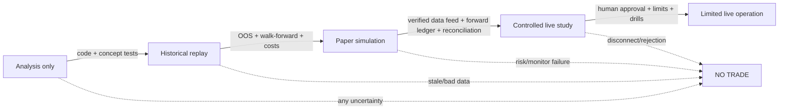
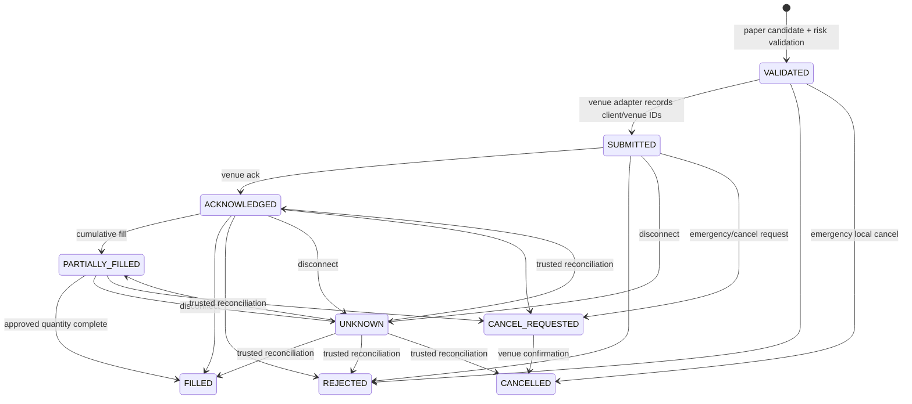

# مراحل التشغيل والتنفيذ الآمن

**الحالة الحالية:** المنصة لا تتصل بوسيط ولا تنفذ أمراً حقيقياً.
الملف `execution/lifecycle.py` هو state machine محلي للتدقيق والـPaper فقط؛ ليس venue adapter ولا يمكنه فتح شبكة أو تفعيل live trading.

## مبدأ الترقية

| المرحلة | ما يسمح به | ما يمنع | بوابة الانتقال |
|---|---|---|---|
| 0 — Analysis only | محركات التحليل، reports، `NO_TRADE` | paper/live order lifecycle | tests للـrules، data contracts، evidence provenance |
| 1 — Historical replay | next-open replay، تكاليف معلنة، DD/PF/expectancy | تغيير القواعد على final OOS | walk-forward، OOS، Monte Carlo، parameter sensitivity |
| 2 — Paper simulation | state machine محلي، idempotency، ledger، kill switch | broker/account/API credentials | توقعات forward مسجلة قبل outcome ومراجعة drift |
| 3 — Forward paper | مزود أسعار read-only موثوق + reconcile | live order routing | data freshness، incident response، fill/reject/reconnect drills |
| 4 — Controlled live study | adapter محدود، حساب منفصل، بشر في الحلقة | auto-scale/auto-withdraw/martingale | موافقة صريحة جديدة، security review، venue certification |
| 5 — Limited live | حدود notional/positions/risk ضيقة | promotion ذاتية أو إلغاء risk gate | فترة مراقبة مستقلة وقرار حوكمة |

## دورة حياة الأمر

## ضوابط التنفيذ المطلوبة قبل أي adapter حقيقي

1. **التحقق قبل الإرسال:** instrument/account allowlist، market status، freshness، signal expiry، direction/stop/target، quantity step/minimum، price bands، max notional، margin، risk approval، event/gap embargo.
2. **Idempotency:** `client_order_id` ثابت لكل intent؛ إعادة الطلب تعيد record السابق ولا تنشئ أمرين.
3. **state verification:** يحتفظ adapter بـvenue order id، acknowledgement/fill/reject timestamp، raw response hash، وsource sequence إن وجد.
4. **رفض الأمر:** يتحول إلى `REJECTED` بسبب موثق؛ لا يعاد الإرسال تلقائياً بسعر/حجم جديد.
5. **انقطاع الشبكة:** الأوامر in-flight تصبح `UNKNOWN`؛ لا يفترض النظام أنها ألغيت. يعاد الاتصال ثم يطلب snapshot من venue ويعمل reconciliation. عدم ظهور order في snapshot لا يثبت الإلغاء.
6. **إيقاف طوارئ:** يمنع intents جديدة؛ يلغي المحلي المعلق ويطلب cancel للـin-flight. لا يدّعي إغلاق مركز حقيقي إلا بعد تأكيد venue ومطابقة position.
7. **حدود صارمة:** `RiskManagementEngine` و`PortfolioRiskBook` خارج adapter. لا يسمح للـexecution أو ML بتجاوزها.
8. **سجل غير قابل للتنصل:** event ledger للقرار، risk assessment، intent، adapter response، reconciliation، وapproval actor/time.
9. **موافقة بشرية:** لكل تفعيل live في البداية approval محدد الصلاحية والنطاق؛ لا يكفي زر واجهة عام.

## ما ينفذ الآن في الكود

- `OrderLifecycleManager.prepare()` يمنع `ANALYSIS_ONLY` و`LIVE_DISABLED` ويرفض signal/levels/risk غير الصالحة.
- يمنع التكرار بواسطة `client_order_id`.
- يسجل validation/submission/ack/fill/reject/cancel/disconnect/reconciliation events بتسلسل محلي.
- يجعل الحالة `UNKNOWN` عند الانقطاع بدلاً من افتراض outcome.
- `emergency_stop()` يحجب intents الجديدة؛ لا يرسل أي نداء خارجي.

## ما يتطلب خدمة خارجية وموافقة صريحة

- Broker/venue adapter read-only ثم order adapter.
- حساب منفصل عن الأموال الأساسية وصلاحيات أقل ما يمكن.
- API keys في secret manager، لا في البيئة المحلية أو Git أو client-side dashboard.
- WebSocket/REST reconnect، rate limit، clock sync، venue order/position reconciliation.
- سياسات hedge/netting، partial fills، market/limit/stop order semantics، holidays، margin/liquidation.
- security review وdisaster-recovery drill وموافقة بشرية قبل تشغيل live.

هذا التصميم لا يمنح تصريحاً لتشغيل تداول حقيقي. لا يضاف adapter حقيقي ولا تستخدم credentials من دون موافقة المستخدم الصريحة اللاحقة.
